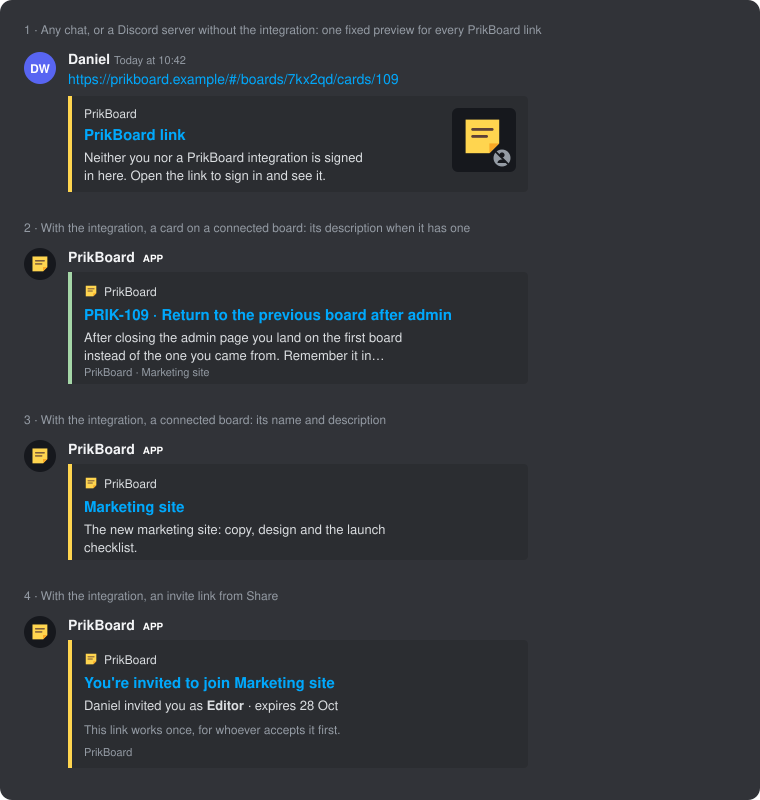

# Design: Discord link previews

Status: built. Part 1 (PRIK-142) is the meta tags in `src/web/index.html` and the PNGs in `src/web/public` (sources in `src/web/icons`). Part 2 runs inside the API (PRIK-149, PRIK-179). The pieces are:

- `Integrations/`:
  - `DiscordGateway`, the Discord connection itself
  - `DiscordBot`, its settings
  - `LinkPreviews` and `ChatPreviews`, what links and ids preview as
  - `ChatActivity` and `DiscordActivityTarget`, live previews and updates (shared with Slack)
  - `ChatSaves`, Save to PrikBoard
  - `ChatAccounts`, who a Discord user is
  - `Embeds`, how all of it looks
- `Endpoints/DiscordEndpoints.cs` and `Endpoints/DiscordBotEndpoints.cs`
- In the web app:
  - `components/IntegrationsDialog.tsx` (board menu → *Integrations*)
  - `components/DiscordBotSettings.tsx` (Admin → *Instance*)
  - `components/ChatAccountPage.tsx` (`#/connect/discord-account`, shared with Slack's `#/connect/slack-account`)
  - The Discord section of Account

### One setup for everything

A board connects to channels. Every connected channel does three things for its board, and board owners set all three in one place, *Integrations*:

| Per connected channel | What it does | Default |
| --- | --- | --- |
| Previews | Links and bare ids such as `PRIK-149` show an embed that keeps up with the card for a week | Always on |
| Updates | Posts the board activity the channel follows | Off |
| Save here | *Save to PrikBoard* in this channel saves to this board, in a bucket of the owner's choice | The first bucket |

A connection to the whole server previews everywhere. Updates and a save bucket need a channel picked as well, and both kinds of connection can exist side by side.

Every action of the bot uses the same rules:
- **Who someone is.** One rule, `ChatAccounts.FindUserAsync`, says who a Discord user is in PrikBoard. Actions on someone's behalf run with that person's own role.
- **What changed.** The bot learns what changed from one source, the card history.
- **How it looks.** Everything is drawn by one embed builder.

It has not been tried against Discord yet, because that needs a public host (open question 10).

Part 2 started as a separate bot process that each server connected with a code pasted back into Discord. That was hard to set up: an env var on the API, a second container, and four steps per server. It was replaced by a bot inside the API that an admin sets up at runtime, plus a channel picker for board owners. The `DiscordBotInApi` migration deleted the old per-server tokens. Servers that were already connected keep their boards and channels, and their previews come back once an admin enters the same bot's token.

## Goal

When someone pastes a PrikBoard link in Discord, the chat should show what it points to, as far as it is allowed to. There are three cases:

| Where | Link | Preview |
| --- | --- | --- |
| Any chat app, or a Discord server without the integration | Any PrikBoard link | A small card: the PrikBoard icon with a *not signed in* badge. It says this is a PrikBoard link and that neither you nor the integration is signed in here. Nothing from the board. |
| A Discord server with the integration, for a board connected to it | Board or card | The board's name and description. For a card, its readable id, title and description, when there is one. |
| A Discord server with the integration | Invite (from *Share*) | *You're invited to join &lt;board name&gt;*, with the role and expiry. |



### Constraints

- **Links stay as they are.** Board and card links keep everything behind the `#` (`/#/boards/{shortId}/cards/{number}`), and so do invites (`/#/invite/{token}`). There are no new share links or server-rendered pages.
- **Set up while PrikBoard runs.** No redeploy, no second container and no environment variable is needed. An admin pastes a bot token, and board owners pick channels.

## Why the chat app's own preview sees so little

Chat apps build link previews by fetching the URL themselves, anonymously. Browsers never send the part after `#` to the server, so every PrikBoard link reaches the server as `/`, and the crawler isn't signed in either. The chat app's own preview can therefore only ever be one fixed preview for all PrikBoard links, built from `index.html`.

The integration gets around both limits. The bot reads the link from the message text, fragment included, and looks it up as the Discord server it was pasted in.

## Part 1: the anonymous preview

### Meta tags in `index.html`

`src/web/index.html` has static meta tags. They are the same for every link, since every link is `/` to a crawler:

```html
<title>PrikBoard</title>
<meta name="description" content="Neither you nor a PrikBoard integration is signed in here. Open the link to sign in and see it.">
<meta property="og:site_name" content="PrikBoard">
<meta property="og:type" content="website">
<meta property="og:title" content="PrikBoard link">
<meta property="og:description" content="Neither you nor a PrikBoard integration is signed in here. Open the link to sign in and see it.">
<meta property="og:image" content="/og-signed-out.png">
<meta property="og:image:width" content="256">
<meta property="og:image:height" content="256">
<meta property="og:image:alt" content="The PrikBoard card with a not-signed-in badge">
<meta name="twitter:card" content="summary">
<meta name="theme-color" content="#ffd54f">
```

- **Small card.** `twitter:card` `summary` with a square image gives the small thumbnail on the right of the card, not a large banner.
- **No `og:url`.** It would tell the chat app that every link is the home page. Without it, the card links to what was pasted.
- **The image** (`src/web/public/og-signed-out.png`, 256 × 256) is the card logo on the Night shift background, with a small round badge in a corner. It is a PNG because many crawlers don't render SVG. `icon-512.png` and `apple-touch-icon.png` sit next to it, and the bot uses the icon.
- **Relative image URL.** Discord and most crawlers resolve `og:image` against the page URL. If one doesn't, the build can write the absolute URL from a `PRIKBOARD_PUBLIC_URL` build variable. Decide this when there is a host.
- **`theme-color`** `#ffd54f` (the logo's yellow) colors the bar beside Discord's card.

The text is the same wherever it appears: the home page, a board, a card, an invite. It never says which kind of link it is, because the server can't tell.

## Part 2: the Discord integration

### Setting up the bot (admins)

The instance has one Discord bot, and it runs inside the API (`Integrations/DiscordGateway.cs`). It connects out to Discord's gateway, so it needs no inbound port. To set it up, an admin goes to Admin → *Instance* → *Discord bot*:

1. Create an application at [discord.com/developers](https://discord.com/developers/applications).
2. On its *Bot* tab, turn on **Message Content Intent**, so the bot can see pasted links. Turn off **Public Bot**, so only you can add it to servers.
3. Click *Reset Token* there and paste the token into PrikBoard, then click *Connect*.

What happens when the token is saved:

- **The check.** setDiscordBot first asks Discord about the token (`DiscordApplications`, `GET /applications/@me`). A wrong token, or one without the Message Content intent, is a 400 on the admin page.
- **Storage.** The token is stored encrypted with Data Protection (`DiscordBotSettings.ProtectedBotToken`, purpose `PrikBoard.DiscordBot`), like sign-in provider secrets.
- **Connecting.** `DiscordBot.LoadAsync` hands the token to the gateway, which logs the old one out and the new one in, without a restart.
- **The public address.** This is the PrikBoard address links are matched against. It defaults to the address the admin is using and can be changed on the same page.

*Invite to a server* opens Discord's invite link, with scope `bot` and permissions `93248`. Those are View Channels, Send Messages, Embed Links, Read Message History and Add Reactions (the 📌 on saved messages), plus Manage Messages. Manage Messages is optional: it only lets the bot hide Discord's own "not signed in" preview above its reply. Servers the bot joined with the older permissions (`93184`) work too, without the 📌.

The same section shows the bot's state:

- **Online**, **Connecting**, or **Failed** with the reason. For example, Discord closes the connection with 4014 when the intent is off, and 4004 when the token was reset.
- The servers the bot is in, with the boards previewed in each. *Leave* makes the bot leave a server and disconnects its boards.
- A warning while the bot is public.

getSystemChecks lists the bot once it is set up.

`Discord:BotToken` and `Discord:PublicUrl` in configuration still work and win over the admin page, which then shows them read-only. That mirrors `Auth:Providers` and sign-in providers.

PrikBoard runs as one instance, and that matters here too: two instances with the same token would each answer every message.

### The grant

Everyone who can read a channel sees every embed posted there, so access is granted to a Discord server (a *guild* in Discord's API), not to one person. The grant reads: *this server may see this board*.

Each connected guild is an `Agent` (issuer `discord`, `ClientId` = the guild id). It is added as a **Viewer** `BoardMember` of each board an owner connects. That reuses what already exists:

- The bot looks boards up as that agent (`BoardAccess.RoleOnBoardAsync`), so it can only read what the server was given.
- The connection shows in the board's members list, with the guild's name and a Discord badge. Removing that member disconnects the board.
- Discord servers are never assignees (`BoardAccess.AssignableIds`).

The tables are shared with Slack (`Domain/Chat.cs`, docs/slack.md): every row has a `Platform`, `Discord` here. The `ChatWorkspaces` migration moved the old Discord tables into them.

A `ChatWorkspace` row keeps what the agent can't hold:

| Field | Meaning |
| --- | --- |
| `WorkspaceId` | Discord's id for the server (a snowflake, kept as text) |
| `AgentId` | The guild's `Agent` |
| `ConnectedById` | The board owner who made the latest connection |
| `ConnectedAt` | When |

There is also a `ChatBoardChannels` row per connected board, saying where the board may be previewed and what each channel does:

| Field | Meaning |
| --- | --- |
| `WorkspaceId`, `BoardId` | The connection. The membership is the grant; this row only narrows it. |
| `WholeWorkspace` | Links preview in every channel of the server |
| `Channels` | The channels picked for the board (jsonb). Each has its id and name, the `Updates` it follows (flags, stored as a number) and its `SaveBucketId`. |

The `DiscordActivity` migration turned the old "whole server" (a null list of channels) into `WholeServer` (now `WholeWorkspace`).

Discord's own server, channel and message ids are not personal data about PrikBoard users, so storing them in plain text is fine. Discord *user* ids are only stored as keyed hashes (see Who is who).

### Connecting a board (owners)

In the board menu, *Integrations* (owners only) opens `IntegrationsDialog`. It lists the servers previewing the board, each with a *Whole server* chip (when connected that way), a chip per channel and a *Disconnect* button. Below the list:

1. Pick a server the bot is in. These come from listDiscordServers, which reads the gateway's cache.
2. Pick one of its text channels, or *Whole server*. Only channels where the bot may read and post are offered.
3. Click *Connect* (connectDiscordChannel).

What the choices do:

- **Another channel** adds to the list. A board takes at most 50 channels of one server (`ChatBoardChannels.MaxChannels`), and a 51st is a 409.
- **Whole server** is added next to the channels, which keep their settings.
- **The cross on a chip** takes that channel, or the whole server, away (removeDiscordChannel, removeDiscordWholeServer). When nothing is left, the server is disconnected; the dialog asks first.
- **Clicking a channel's name** opens its settings (updateDiscordChannel, saved at once):
  - The updates it posts: new cards, moves between buckets, assignments, agents starting or stopping work.
  - The bucket *Save to PrikBoard* puts cards in.
  - A 🔔 on the chip shows that the channel posts updates.

The server and channel names come from the bot, not from the request, so a board can only be connected to a channel the bot really is in. Connecting is for browser sessions only (403 for tokens), because the connection records who made it.

Who may connect what: any owner may connect their own board to any server the bot is in. The board's content is theirs to share. The servers are the ones the bot's owner put it in, which is why the admin page says to turn off *Public Bot*. Admins can make the bot leave a server.

If no admin has set up a bot, the dialog says so: admins get a link to the admin page, and other people are asked to contact an admin. If the bot is in no server yet, the dialog says that instead.

### Previews

For every message, the bot works through these steps:

1. It ignores messages from bots, including its own, and messages outside servers.
2. It finds what to preview (`LinkPreviews.Sources`), up to five per message:
   - First, links that loosely match the public address (`LinkFinder`). A link wrapped in `<…>` is skipped, since that is Discord's way of posting a link without a preview.
   - Then bare readable ids such as `PRIK-149` outside those links. Ids are uppercase, with no letters or digits run on.
3. It looks each one up with `LinkPreviews.FindAsync` (guild, source, channel, public address). Each lookup counts against a limit per server (`RateLimits:LinkPreviewsPerMinute`, 60), so one busy server can't use up the others' previews.
4. It posts one reply with an embed per source that got a preview (`Embeds`) and stays silent about the rest. Saying "no access" would confirm that the board exists.
5. It remembers the reply (`ChatPreviewMessage`: the sources, and the cards and boards shown) for a week, so it can keep the reply up to date.
6. With *Manage Messages*, it removes Discord's own anonymous preview from the message it answered (suppress embeds).

A message in a thread counts as being in the thread's channel.

A bare readable id previews only when it can mean just one board: one connected to this channel (picked, or the whole server), with that key. Keys aren't unique, so an id that two boards connected there could mean previews nothing.

`LinkPreviews.FindAsync` returns one of:

| `Kind` | When | Fields |
| --- | --- | --- |
| `Card` | A card link (either path form, `CardLinks.TryParse`) or readable id on a board the guild's agent can read, in an allowed channel | `ReadableId`, `Title`, `Description`, `Color`, `BoardName`, `Path`, `Bucket`, `Tags`, `Assignees` (names), `Checklist` (`3/7`, when there is a text description too), `WorkingFor` (while an agent works on it) |
| `Board` | A board link (`/#/boards/{shortId}` or `/#/boards/{boardId}`) the agent can read, in an allowed channel | `BoardName`, `Description`, `Path` |
| `Invite` | `/#/invite/{token}` for an open invite | `BoardName`, `Role`, `InvitedBy`, `ExpiresAt` |

Everything else gets nothing, and it all looks the same:

- a link to another host
- a board or card the guild can't see, or that doesn't exist
- a used, revoked or expired invite
- a server that isn't connected to anything
- a channel outside the board's `Channels`

The individual rules:

- **Card description.** Cards have no description field. The description is the first Text component on the card's canvas, top to bottom and then left to right. Its Markdown is reduced to plain text and cut to 300 characters at a word, with an ellipsis. A card whose content is only checklists gets `3/7 done` instead (`CardPreview.Describe`).
- **Board description.** `Board.Description`, cut the same way, or nothing.
- **Invites** reuse `previewInvite`'s lookup and are never spent. They need no membership or channel, since anyone holding the link is meant to see the board's name. They do need a server where the bot is connected to some board.
- **Host check.** A link counts only when its origin and path match the public address, so a look-alike host isn't previewed as PrikBoard.

### What the embeds show

All embeds use the PrikBoard icon and name as author, so they read as one thing, and as the anonymous preview.

- **Card**: the title is `PRIK-109 · <card title>`, linking to the card. Then the description, when there is one. Small fields follow: 🤖 *Agent at work* (for whom), *Bucket*, *Assigned* (names), *Tags* and *Checklist* (`3/7 done`). The footer is the board name and the color is the card's fill. People's names are visible to everyone in the channel; that was decided (open question 5).
- **Board**: the title is the board name, linking to the board. Then the description, when there is one. The color is the logo's yellow.
- **Invite**: the title is *You're invited to join &lt;board name&gt;*, linking to the invite. Then *Daniel invited you as Editor · expires 28 Oct*, and a line saying the link works once, for whoever accepts it first. There is no board description: an invite shows only what `previewInvite` shows.
- **No longer available**: what a remembered preview turns into once its card is deleted, or its board is no longer previewed in that channel.
- **Updates**: the board's name, then one line per card, for example `➡️ PRIK-12 Fix login To do → **Done** · Jimmy`.
- **Snapshot** (`/prikboard board`): a field per bucket with its count and first five cards, and *Agents at work*. The footer counts the last 24 hours (added, moved).

### Live previews and updates

`ChatActivity`, a background service shared with the Slack app (docs/slack.md), looks at the card history (`CardChange`) every 5 seconds (`Chat:ActivitySeconds`, or the older `Discord:ActivitySeconds`). Every write path records history, so this one place sees every change without hooks in handlers. Each look reaches 30 seconds before the last change seen, for saves that commit late. Quick edits merged into an earlier change show again with a later time.

- **Previews follow their cards.** For each changed card, the remembered replies showing it from the last week are edited to match (`ChatPreviews.RefreshAsync`, `IDiscordGateway.EditAsync`). Disconnecting a board from a server or channel, or the bot leaving a server, queues the board's replies too (`RefreshBoard`). A source that previews nothing any more shows *No longer available*. A reply deleted in Discord is forgotten. Older replies are dropped every hour.
- **Updates.** A change's entries map to what channels can follow:
  - created, copied, moved here or restored → new cards
  - bucket → moves
  - assignees added → assignments
  - agent working on or off → agent work

  Each channel picked for the board collects what it follows, if the server's agent is still on the board. After `Chat:UpdatesDelaySeconds` (30; the older `Discord:UpdatesDelaySeconds` still works), it gets one post per board. Moves of the same card become one, from the first bucket to the last. A move back to where the card started is left out.
- While the bot is offline nothing is saved up, so coming back online doesn't flood channels.

### Save to PrikBoard

On any message, *Apps → Save to PrikBoard* (a message command the bot registers when it comes online):

1. **Who it is.** If the bot doesn't know the person (see Who is who), it replies privately with a *Connect your PrikBoard account* button and stops.
2. **Where it can go.** The boards the person can edit (Editor or Owner) that are connected to this server (`ChatSaves.TargetsAsync`). Boards connected to this channel come first, each with the channel's save bucket or the board's first bucket. With no such board, the bot says so privately.
3. **Choosing.** A private reply with a board menu (when there are several), a bucket menu, the title (the message's first line, editable in a small form) and *Save*. The choices wait for 15 minutes.
4. **Saving.** `ChatSaves.SaveAsync` creates the card through createCard as the person, with `CardHistory.ActingAs`, so their role decides and the card's history names them. The card gets:
   - the message quoted in a Text component, with "From **author** in #channel, time"
   - a link back to the message
   - up to four of its images, fetched from Discord's file hosts only (`cdn.discordapp.com`, `media.discordapp.net`)
5. **Telling the channel.** The private reply then shows the new card's preview with an *Open in PrikBoard* button. The bot reacts 📌 on the message, which needs *Add Reactions* (in the invite's permissions, 93248), so the channel sees it was saved.

`/prikboard board` shows the board connected to the channel (`ChatPreviews.SnapshotAsync`), only to whoever asked.

### Who is who

`ChatAccounts.FindUserAsync` is the one rule for every action the bot takes for a person:

- **A Discord sign-in.** Someone who signs in to PrikBoard with a Discord sign-in provider is known by that sign-in: their `UserIdentity` holds the keyed hash of their Discord id.
- **A link.** Anyone else links once. The bot's button opens `#/connect/discord-account?code=…` with a code that works for 10 minutes, kept in memory.
  - The page shows the Discord name the code is for and warns to link only one's own account. It calls previewDiscordAccountLink, then linkDiscordAccount (session, `SameOrigin`).
  - The link (`ChatAccount`) keeps a keyed hash of the Discord id (`KeyedHasher.Subject("discord-bot", id)`), never the id.
  - Account → *Discord* shows the link and unlinks it (getDiscordAccount, unlinkDiscordAccount).

Linking only lets that Discord account save cards as the person, on boards they can edit anyway. The page's warning covers someone sending their own link to another person.

## Open questions

1. ~~**Bot credential.**~~ Decided, then changed. The first version gave each guild a `pb_pat_` token through a PKCE paste flow, and the bot ran on its own. Now the bot runs in the API with one token that an admin sets, and guilds need no credential: the bot looks links up as the guild's agent.
2. ~~**Invites in public channels.**~~ Decided: invites preview in any channel the bot posts in, with the line saying the link works once, for whoever accepts it first.
3. ~~**Channel limits per board or per server?**~~ Decided: per board. Owners pick the channels, or the whole server, under *Integrations*.
4. ~~**Who may connect a server?**~~ Decided: any board owner, to any server the bot is in. The bot's owner decides which servers those are (Public Bot off), and admins can make it leave one.
5. ~~**More on the card embed.**~~ Decided: bucket, tags, assignees by name, checklist progress and an agent at work, as inline fields. Names are visible to the whole channel; showing them is what makes previews and updates useful.
6. ~~**Readable ids in plain text.**~~ Decided: yes, but only for boards connected to that channel, and an id two of them could mean previews nothing.
7. ~~**Per-person check.**~~ Decided: no for reading. The whole channel sees the embed, so the server grant and the channel limits are what protect a board. Writing (Save to PrikBoard) is done as the person, with their own role.
8. ~~**Revoked access.**~~ Decided, then changed. Replies are remembered for a week and turn into *No longer available* once their board is disconnected or the card is gone. Older replies stay as snapshots.
9. ~~**Images.**~~ Decided: none in previews yet. Later, the bot could attach the card's first image to the reply (`attachment://`). Save to PrikBoard does take a message's images onto the card.
10. **Hosting.** Nothing is deployed yet. Discord's crawler needs a public host, and the bot is only useful when the public address is one people can open.
11. ~~**Notifications.**~~ Decided: per channel, board owners tick what a channel follows. The bot learns what changed from the card history and gathers it into one post per board.
12. **Later.**
    - A 📌 reaction as a shortcut for Save to PrikBoard.
    - Buttons on embeds (Move to…, Assign me, Mark done), which only need a button now that people are known.
    - A daily digest on a schedule.
    - Image thumbnails in previews.
